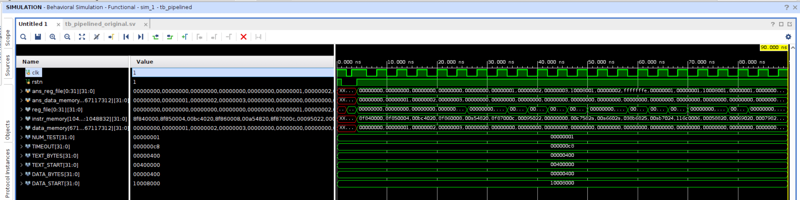

## Experimental Result




## Answer the Following Questions

<InfoBox>
1\. (2%) List out the equation to detect EX & MEM hazard in forwarding unit. Which part of the
equation in textbook p.369 is wrong?
</InfoBox>


EX hazard:

```py
if (EX/MEM.RegWrite
  and (EX/MEM.RegisterRd != 0)
  and (EX/MEM.RegisterRd == ID/EX.RegisterRs))
  ForwardA = 10

if (EX/MEM.RegWrite
  and (EX/MEM.RegisterRd != 0)
  and (EX/MEM.RegisterRd == ID/EX.RegisterRt))
  ForwardB = 10
```


MEM hazard:

```py
if (MEM/WB.RegWrite
  and (MEM/WB.RegisterRd != 0)
  and NOT (EX/MEM.RegWrite and (EX/MEM.RegisterRd != 0)
             and (EX/MEM.RegisterRd == ID/EX.RegisterRs))
  and (MEM/WB.RegisterRd = ID/EX.RegisterRs)) ForwardA = 01

if (MEM/WB.RegWrite
  and (MEM/WB.RegisterRd != 0)
  and NOT (EX/MEM.RegWrite and (EX/MEM.RegisterRd != 0)
             and (EX/MEM.RegisterRd == ID/EX.RegisterRt))
  and (MEM/WB.RegisterRd = ID/EX.RegisterRt)) ForwardB = 01
```

課本 P.369 的 MEM hazard 少判斷「當下 NOT EX hazard」，否則當 double data hazard 出現時：

```asm
add $1, $1, $2
add $1, $1, $3
add $1, $1, $4
```

第三條 `add $t1, $t1, $t4` 會誤判成來自前兩條指令的 MEM hazard，而非前一條指令的 EX hazard（後者才對）。


<InfoBox>
2\. (2%) In forwarding for `beq`, is forwarding from MEM/WB to ID needed? Why?
</InfoBox>

不需要：
- WB stage 將新資料寫回 register file 時是在同一個 clock 的前半（`negedge clk`）
- register file 讀取以及 register comparator 是 combinational circuit
- PC 和 pipeline registers 是在 clock 的後半（`posedge clk`）更新

不用做額外的 forwarding 就可以是新的資料。


<InfoBox>
3\. (2%) Briefly explain how you insert 2 stalls when beq reads registers right after lw writes it.
</InfoBox>

讓 hazard detection unit 在 `lw` 的 ID/EX 與 EX/MEM 這兩個 stage 都能連續偵測到需要 stall：
- 1st stall：
    ```asm
    ID/EX.MemRead == 1
      and (ID/EX.RegisterRt == IF/ID.RegisterRs
        or ID/EX.RegisterRt == IF/ID.RegisterRt)
    ```
- 2nd stall：
    ```asm
    EX/MEM.MemRead == 1
      and (EX/MEM.RegisterRt == IF/ID.RegisterRs
        or EX/MEM.RegisterRt == IF/ID.RegisterRt)
    ```


<InfoBox>
4\. (2%) sw right after lw is quite common since copy and paste a data from one address to another
is used frequently. In textbook, a stall is followed by the lw in this case. Is it possible to remove
this stall? How?
</InfoBox>

可以只用 forwarding 就行，參考如下指令：

```asm
lw  $t1, 0($t2)        IF      ID      EX      MEM     WB
sw  $t1, 0($t3)                IF      ID      EX      MEM     WB
```

`sw` 需要寫到 memory 的資料來自於 `lw` 的 MEM stage 結束之後，可以發現剛好接得上。所以就直接仿照 EX stage 那樣再接一個 forwarding unit 於 MEM stage 結束後：

```asm
lw  $t1, 0($t2)        IF      ID      EX      MEM     WB
                                                    \
sw  $t1, 0($t3)                IF      ID      EX      MEM     WB
```
