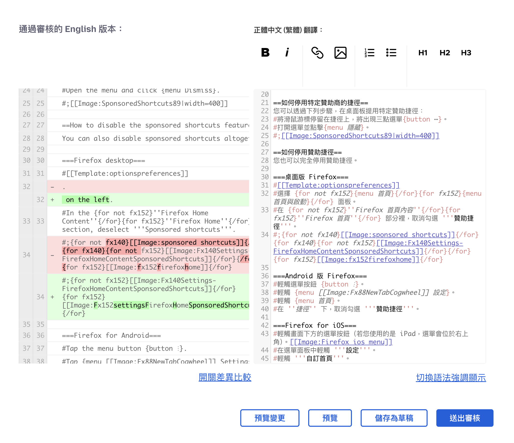
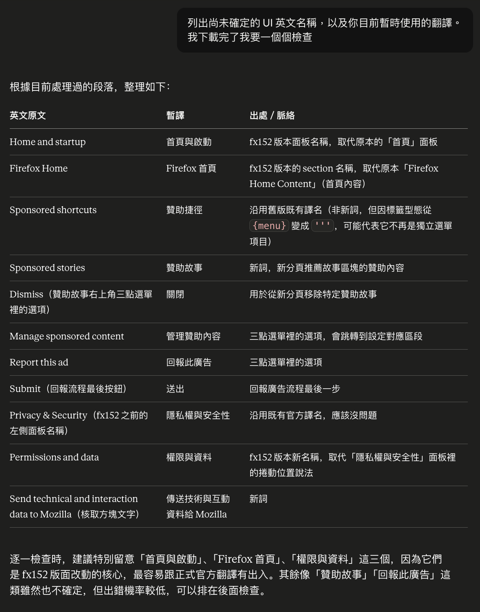
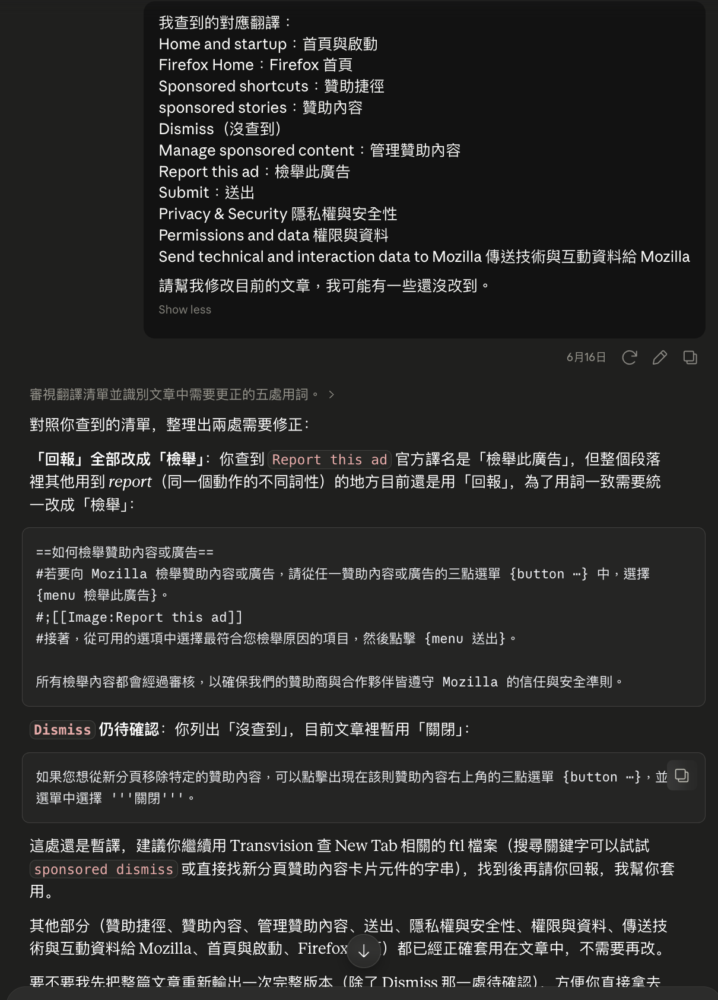
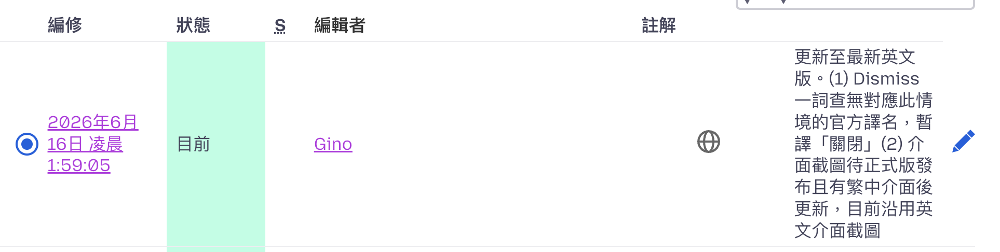

這學期的服務學習課程選擇了自由軟體推廣小組當中的 Mozilla Support 技術支援文章的翻譯工作。由於平時就有在使用 Firefox 瀏覽器並且非常喜歡，因此想藉此機會爲 Mozilla 做出一些貢獻、同時也完整學習並認識開源軟體的精神。

## 工作前準備

正式工作之前做了不少調查與學習。首先在學期初的演講時先學習了什麼是開源。開源 (Open Source) 指的是軟體的原始碼公開，任何人都可以自由查看、使用、修改和散布（但通常會搭配授權條款如 MIT License、GPL、Mozilla Public License，規定大家對這份軟體程式碼的利用範圍，比如是否能商用）。開源的特色不只在於這種無私分享的精神，透過讓所有人都能看到程式碼，任何人都能發現 bug、提出修正、甚至延伸出新功能，即便是沒有技術背景的軟體 user 也能透過「提供使用心得」、「撰寫使用說明」等方式回饋，整個軟體會在公開透明的協作下持續演進，形成一種共贏共榮的模式。

Mozilla 是一個成立於 1998 年的非營利組織，旗下最知名的產品 Firefox 瀏覽器就是開源軟體（前身是 1998 年 Netscape 開放原始碼後誕生的 Mozilla 專案產物）。而我選擇參與的 Mozilla Support（SUMO）計畫，是 Mozilla 官方技術支援知識庫，收錄了大量關於 Firefox 各項功能、設定與疑難排解的說明文章。SUMO 如同 Firefox 秉持開源協作精神，這些支援文章不僅由 Mozilla 官方撰寫維護，更開放給全球志工協助本地化翻譯，讓不同語言的使用者都能取得準確、易懂的技術支援，這也是我這學期主要投入的服務學習項目。

## 工作內容

首先在 [SUMO 網站](https://support.mozilla.org/zh-TW/contribute/l10n) 註冊帳號（並同時聯繫了 MozTW L10n 負責人）後，先閱讀了 [How does support localization work?](https://support.mozilla.org/en-US/kb/how-does-support-localization-work)、[Translating an article](https://support.mozilla.org/en-US/kb/translating-an-article) 與 [How do I update articles after their first translation?](https://support.mozilla.org/en-US/kb/how-do-i-update-articles-after-their-first-translation)，以了解完整的工作流程。此外我還自行搜尋並完整閱讀了相關的指導文章：[自由軟體正體中文化工作流程規範](https://hackmd.io/@l10n-tw/translation_guidelines)、[自由軟體正體中文化翻譯風格指引](https://hackmd.io/@l10n-tw/translation_style_guide)、[資訊科技詞彙翻譯](https://hackmd.io/@sysprog/it-vocabulary)、[中文文案排版指北](https://github.com/sparanoid/chinese-copywriting-guidelines)，當中學到的幾個比較重要的準則：

- 譯文應意思清晰、用詞有依據當前上下文，且符合中文表達習慣，句子請以整體意譯為主。也就是說可適度依照習慣、通順程度，或前後語境，來調整句子結構。
- 約定俗成的常用語應直譯。如常見的 bug 稱「臭蟲」、patch 稱「補丁」。但晦澀的專業術語維持原文不翻譯，如程式開發專用的 lint / linter（原意為毛絮）可維持原文（這種情況下用中文反而更難看懂）。
- 對相同術語所採用的譯詞必須保持一致。
- 一律使用全形標點符號。「中文」與「英文數字」之間要有半形空格，但「標點符號」與「英文符號」之間則不需要空格。

接着是翻譯過程，我是從 [在地化主控台](https://support.mozilla.org/zh-TW/localization) 選擇當下更新需求較爲緊急的文章來翻譯。我會先完整閱讀一遍文章（包含原文與中文），並學習該文章所提及的技術（例如 OHTTP、VPN），確保自己是真的完全理解該文章的情境。隨後再進到類似以下的編輯頁面：

我會將「原文的所有更動」與「舊的中文譯文」先提供給 Claude，請他先提供一版草稿，因爲 SUMO 的文章有不少特殊語法與標籤，可讀性較低，如果純手動更新的話必定會有一些語法疏漏（例如少打一個 `'`）。

<Note>註：事前有先教 Claude SUMO 文章的語法（[給它看了這篇文章](https://support.mozilla.org/en-US/kb/markup-cheat-sheet)）</Note>

但 Claude 生出來的文章我絕對不會不負責任地直接原封不動貼上並提交審核，爲確保翻譯品質，我仍做了以下工作：

### 校正專用術語的譯詞

接著就是開始修改 Claude 的草稿。我會請 Claude 先列出文章中的專用術語與對應的暫譯，之後我再到 [Transvision](https://transvision.mozfr.org/) －由 Mozilla 法國社群開發的翻譯搜尋工具－ 查詢前輩們是如何翻譯某些詞的，以確保術語的一致性。隨後再將查到的結果提供給 Claude 修正。

<Columns noline ratio="1.09fr 1fr">

</Columns>

### 修正不自然的語句

我會完整閱讀一次草稿，並手動修改 Claude 生成的難以閱讀的語句，之後再與 Claude 討論、提出我的意見。上述流程會重複數次直到修改出適合閱讀的版本。以下是討論過程的一些截圖：

### 與 UI 元件相關的翻譯內容

此外，SUMO 的技術支援文章經常會有「引導使用者操作 UI 元件」的教學步驟，碰到這種狀況就必須下載對應版本、對應裝置（Windows、macOS 或 Linux）的軟體以親自確認該翻譯成什麼中文。我在修改「[新分頁中的贊助捷徑](https://support.mozilla.org/zh-TW/kb/sponsor-privacy)」的翻譯時，發現 Firefox 的「Settings > Home」於 152 版本之後改成了「Settings > Home and Startup」，所以我便重新下載了尚在 beta 測試中的新版本，確認應譯爲「首頁與啟動」。

而針對查不到的術語（因爲有些功能在臺灣地區尚未支援），我會先選用一個暫時的譯詞，並在 commit message 寫下備註，等到以後功能更新之後我會再回來修改。

這學期總共修改了 [7 篇文章的翻譯](https://support.mozilla.org/zh-TW/user/ginow514sm/documents)，數量不多因爲較多時間都是花在事前的學習上，且一篇文章其實比我想象中耗時很多。

## 心得、未來目標

最大的心得是翻譯工作的眉眉角角實在多到離譜，真心非常敬佩那些平時就在從事這些工作的志工（而且翻譯肯定也只是他們日常工作的冰山一角）。

下個學期的服務學習我應該仍然會繼續選擇此項目來貢獻。另外可能會優化工作流程，一來是 SUMO 網頁的編輯介面我覺得不太好用（介面沒辦法便寬且原文的地方沒有語法 highlight 導致花很多時間在語句對照），之後再看看能不能搬到 VSCode 之類的編輯器內進行翻譯工作。二來是我發現 Transvision 好像有 API 可用但我還沒調查他們的 docs，如果確定可用的話之後就會改成用腳本去爬術語的譯詞，就不用在網頁內手動一個詞一個詞。

